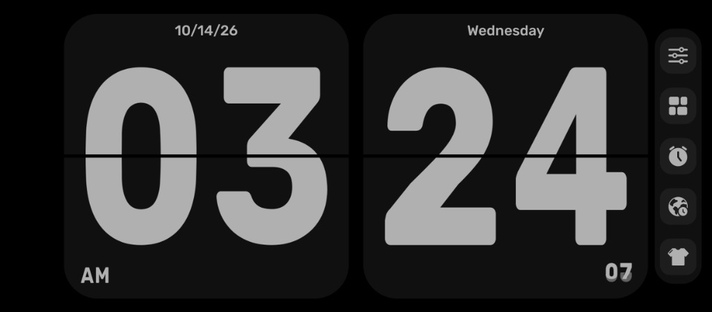

# Floating Clock 🕐

A clean, minimalist floating split-flap flip clock for Windows inspired by mobile flip clocks.



## ✨ Features

- **Split-Flap Animation:** Realistic flip card animation folding the old digit down and unfolding the new digit.
- **Modern Rounded Window:** Borderless, clean rounded corners with subtle theme border and no sharp edges.
- **Top Controls on Hover:** Action bar smoothly fades in at the top right when hovering:
  - 📌 **Pin (Always On Top):** Toggle floating on top of all windows (or double-click anywhere on the clock).
  - ⚙️ **Settings & Timezones:** Open the timezone manager.
  - ➖ **Minimize:** Minimize to Windows taskbar.
  - ✕ **Close:** Close the app (turns red on hover).
- **Multi-Timezone Support with DST:**
  - Formatted city & offset display: `New York (UTC-4)`, `London (UTC)`, `Tokyo (UTC+9)`, etc.
  - **Scroll wheel** on the clock to cycle between configured timezones.
  - Remembers selected timezone automatically across restarts.
- **Responsive Sizing:**
  - Drag edges to resize freely from small (`200×110 px`) to full screen without collapse or digit truncation.
- **Themes & Formats:**
  - Dark (default, matching mobile flip clock), Light, and System follow modes.
  - 12-hour (with AM/PM and seconds) or 24-hour mode.
- **Error Logging:**
  - Global unhandled exception logging to `%LOCALAPPDATA%\FloatingClock\Logs\`.
  - Access anytime via right-click → **Open Log Folder**.
- **Windows Installer:**
  - Inno Setup installer script with versioning and desktop/startup shortcut options.

## ⌨️ Controls

| Action | Control |
|---|---|
| **Move clock** | Click and drag anywhere |
| **Hover controls** | Move mouse over clock → 📌, ⚙, ➖, ✕ appear in top right |
| **Toggle Always On Top** | Click 📌 icon or double-click window |
| **Cycle Timezones** | Scroll mouse wheel up / down |
| **Manage Timezones** | Click ⚙ icon or right-click → **Timezones…** |
| **Resize** | Drag any window edge/corner |
| **Theme / 12h-24h format** | Right-click context menu |
| **Close** | Click ✕ button or right-click → Exit |

## 🛠️ Building & Packaging

### Prerequisites
- [.NET 10 SDK](https://dotnet.microsoft.com/download)
- [Inno Setup 6](https://jrsoftware.org/isdl.php) (optional, for installer build)

### Build
Run the one-click build script:
```powershell
.\build.ps1 -Version "1.0.0"
```
This produces:
- Published application: `publish\`
- Windows installer: `output\FloatingClockSetup-v1.0.0.exe`

## 📄 License
MIT License.
